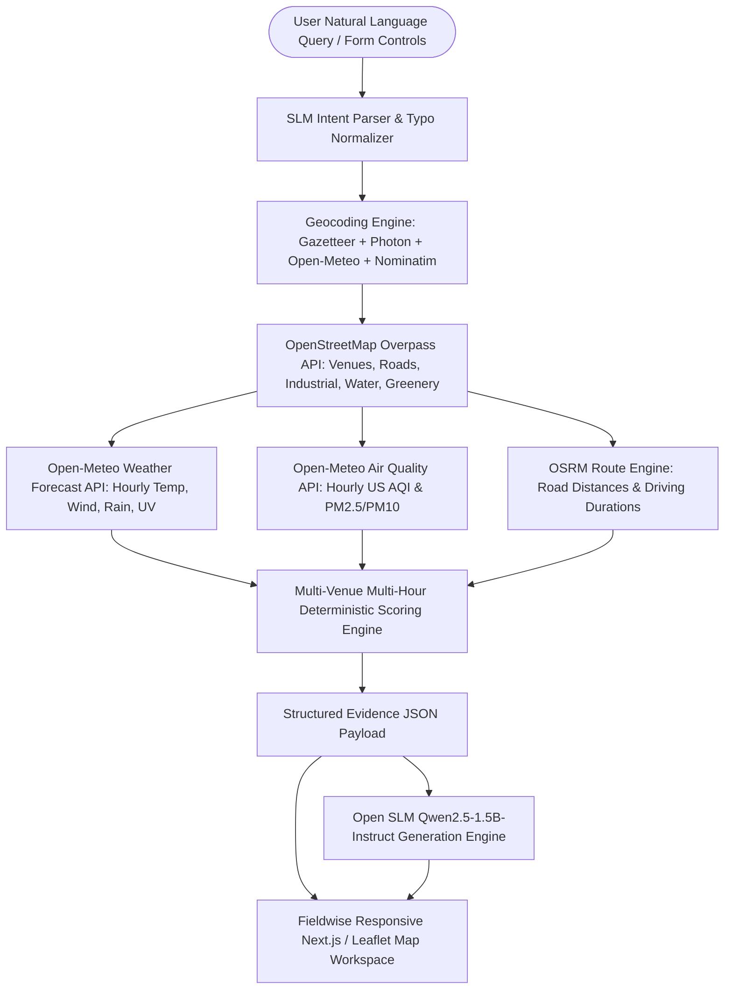

# Fieldwise Architecture & Geospatial Methodology

## 1. Executive System Overview

Fieldwise is an outdoor intelligence platform that resolves the complex question:
**"Where should I go for an outdoor activity, at what time, and what conditions should I anticipate?"**

Instead of delegating this reasoning to a hallucination-prone cloud LLM, Fieldwise employs a **neuro-symbolic architecture**:
- **Deterministic Spatio-Temporal Engine:** Real-time data retrieval from OpenStreetMap (Overpass API), Open-Meteo (Weather Forecast & Air Quality), and OSRM (Routing).
- **Geospatial Physics & Dispersion Models:** Calculates wind direction vectors relative to arterial roads and industrial zones to assess downwind plume pollution exposure.
- **Open-Weights Small Language Model (SLM ≤ 3B):** `Qwen/Qwen2.5-1.5B-Instruct` synthesizes grounded narrative explanations constrained exclusively to the retrieved evidence payload.

---

## 2. Geospatial Calculations & Formulations

### Haversine Great-Circle Distance
$$d = 2R \arcsin\left(\sqrt{\sin^2\left(\frac{\Delta\phi}{2}\right) + \cos(\phi_1)\cos(\phi_2)\sin^2\left(\frac{\Delta\lambda}{2}\right)}\right)$$
where $R = 6371\text{ km}$.

### Forward Compass Bearing
$$\theta = \text{atan2}\left(\sin(\Delta\lambda)\cos(\phi_2), \cos(\phi_1)\sin(\phi_2) - \sin(\phi_1)\cos(\phi_2)\cos(\Delta\lambda)\right)$$

### Downwind Plume Hazard Detection
For a venue with coordinates $(lat_v, lon_v)$ and a nearby arterial road or industrial emitter at $(lat_h, lon_h)$:
1. Calculate the hazard-to-venue bearing $\theta_{hazard \to venue}$.
2. Compare with prevailing hourly 10m wind direction $\theta_{wind}$.
3. If $|\theta_{wind} - \theta_{hazard \to venue}| \le 45^\circ$, the venue is located directly **downwind** of the emissions corridor.
4. Apply an explicit penalty weighted by rush-hour vehicular volume and personal respiratory vulnerabilities (e.g., $2.5\times$ penalty multiplier for asthma profiles).

---

## 3. Data Sources & Attributions

| Source | API Type | Role | Terms & Attribution |
| :--- | :--- | :--- | :--- |
| **OpenStreetMap** | Overpass API & Photon | Candidate venues, road networks, water bodies, industrial zones, parks | *© OpenStreetMap contributors (ODbL)* |
| **Open-Meteo** | Forecast API | Hourly temperature, apparent temp, rain prob, wind speed/direction, UV index | *Open-Meteo (CC-BY 4.0)* |
| **Open-Meteo** | Air Quality API | Hourly US AQI (EPA scale), PM2.5, PM10 | *Open-Meteo / Copernicus Atmosphere Monitoring* |
| **OSRM** | Routing API | Highway route distances & free-flow driving duration estimates | *OSRM / © OpenStreetMap contributors* |
| **Qwen 2.5** | Hugging Face Transformers | Open-weights SLM inference (1.54B parameters) | *Apache 2.0* |
